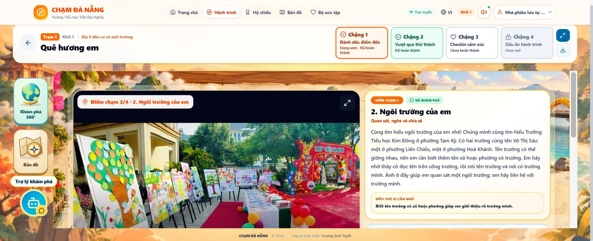

# Kiểm thử trình duyệt thực tế — 28/10/2026

Báo cáo này bổ sung lần kiểm thử trước. Đã kết nối được trình duyệt Chrome của người dùng và Google AI Studio. Không còn coi lỗi truy cập terminal.local là bằng chứng AI Studio bị chặn.

## Google AI Studio
- Mở được dự án CHẠM ĐÀ NẴNG, màn hình Preview và bảng GitHub sync.
- Bảng sync ghi repository gvsinhtuyet-oss/Ch-m-N-ng, nhánh main. PR #20 vẫn chưa được gộp, vì vậy bản này không dùng để nghiệm thu PR #20.
- Thao tác: bỏ qua giới thiệu → khám phá tự do học sinh → Khối 1. Kết quả: màn hình lỗi “Chưa mở được màn hình này”.
- Nhật ký App ghi Invalid hook call và Cannot read properties of null (reading 'useState') tại DanangAssistantChat. Tải lại Preview và thử lại vẫn gặp lỗi.
- Nhật ký Backend ghi Auth storage HTTP 403 PERMISSION_DENIED / Missing or insufficient permissions và lỗi kết nối kho tài khoản Firestore. Không thay đổi quyền hoặc luật Firestore.
- Đã thử quy trình Remix để có bản QA riêng. Chưa có URL hoặc bản sao hoàn tất được xác minh; không coi thao tác này là đã tạo được preview PR #20. Không Publish, không sửa mã main.

## Ứng dụng đã xuất bản
URL: https://chamdanang-gddp.ai.studio/

- Vào chế độ khám phá tự do Khối 1 và mở màn hình Hành trình được.
- Lần mở trạm Quê hương em đầu tiên lỗi: Unable to preload CSS for /assets/StationView-riVqSW0x.css. Chưa xác định nguyên nhân gốc (cache/deployment/network).
- Sau thao tác Tải lại ứng dụng, vào lại Khối 1 và mở Quê hương em thành công. Rita và các menu hiển thị.
- Điểm 1 hiện **3 đáp án**: Một trò chơi; Nơi em sống và gắn bó với người thân; Một món ăn. Đây chưa phải phiên bản hai đáp án của PR #20.
- Đã chọn sai “Một trò chơi” và bấm KIỂM TRA: có phản hồi “Chưa đúng rồi”, hướng dẫn thử lại sau 2 giây.
- Đã chọn lại đáp án đúng và bấm KIỂM TRA: có phản hồi “Chính xác!” và nút KHÁM PHÁ ĐIỂM TIẾP THEO.
- Bấm nút tiếp theo chuyển sang “2. Ngôi trường của em”, ảnh và lời dẫn tương ứng thay đổi.
- Phiên khám phá tự do hiện có sẵn trạng thái đã khám phá các điểm và hoàn thành Chặng 1/2; không dùng phiên này để xác nhận mở khóa lần đầu hoặc lưu tiến độ tài khoản mới.

## CI PR #20
Job 122559582377 đã hoàn tất: TypeScript và bài kiểm thử Journey maps, two-option checkpoints and reward persistence đều đạt. CI tổng thể lỗi tại Grade 1 integrated presentations and exact mappings (lỗi baseline đã ghi nhận); các bước sau bị bỏ qua.

## Chưa được xác minh
- Chưa tải được mã PR #20 vào một preview độc lập trong AI Studio.
- Chưa nghiệm thu 25 trạm mới trên trình duyệt hoặc mobile/tablet.
- Chưa nghe âm thanh thực tế, nhận bản đồ Chặng 4, kiểm tra bộ sưu tập bản đồ/đăng nhập lại bằng tài khoản thử.
- Không gộp main và không xuất bản ứng dụng chính.
