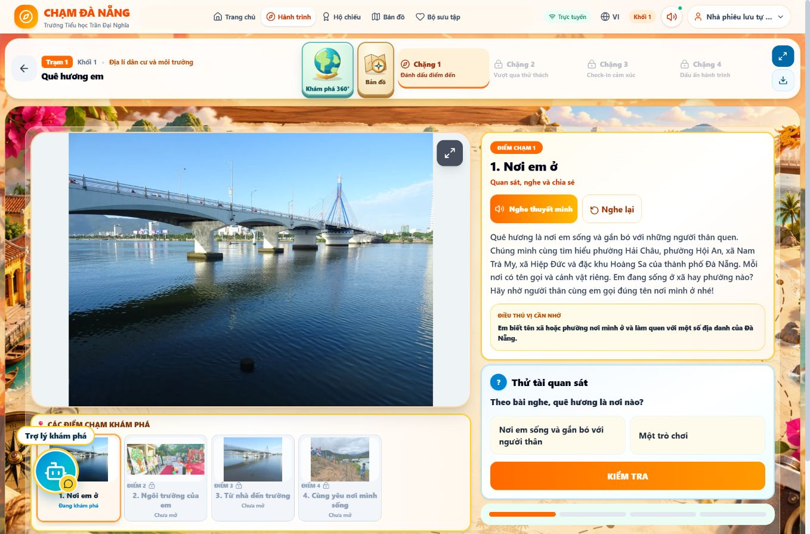
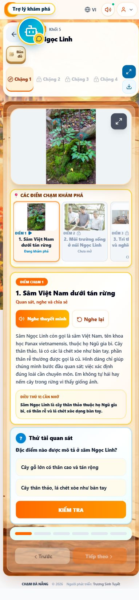

# Kiểm tra Cloudflare thực tế — 28/10/2026

Trạng thái: bản thử đã hoạt động công khai, CHƯA nghiệm thu đầy đủ, CHƯA gộp PR21.

## Đã triển khai

- Project Pages `chamdanang-gddp`, account `aaa9a25aacbd44596b54af8f82cbd1cc`.
- URL ổn định: https://chamdanang-gddp.pages.dev
- Bản sửa desktop: https://15311705.chamdanang-gddp.pages.dev
- Source `421c6732a090f31942a17c1a5cfd86490600710f`, deployment `15311705-a3a2-456d-97bc-5b300f64e3ae`.
- GitHub integration đã có sẵn quyền đúng repository. Không cấp thêm quyền, không bật Billing, không sửa dự án khác. Dashboard Free có giới hạn 100.000 requests/ngày.
- Production branch TẠM THỜI là `deploy/cloudflare-preserve-api-20261028` để nghiệm thu bản thử. Chưa chuyển main và chưa tuyên bố main auto-deploy.
- Push commit 421c673 tự kích hoạt deployment mới sau 056028b; đã xác minh automatic deployment của nhánh thử qua dashboard và lỗi CSS đã hết trên URL ổn định.
- Cloudflare build mặc định Bun lỗi khóa esbuild cũ. Cấu hình đã sửa thành `SKIP_DEPENDENCY_INSTALL=true`, `NODE_VERSION=22`; lệnh `npm ci --no-audit --no-fund && npm run lint && npm run build`; output `dist`.

## Kiểm tra qua Chrome đã kết nối

- Mở link Pages mới không yêu cầu đăng nhập Cloudflare/Google; trang giới thiệu, video, chế độ học sinh tự do mở được.
- `/api/health` qua Pages Function trả JSON: Firestore đọc connected, ghi connected, Admin ready=true, database và revision backend gốc giữ nguyên.
- Đã mở Chặng 1 của **25/25 trạm**, đủ 5 khối; kiểm tra **câu hỏi đầu của từng trạm** đều có đúng hai lựa chọn và ảnh đang hiển thị không có naturalWidth=0. Bằng chứng dữ liệu DOM: [cloudflare-25-station-desktop.json](qa/cloudflare-25-station-desktop.json). Không đồng nghĩa đã trả lời cả 121 câu qua UI.
- Desktop 1366×900: grid ngoài 1342px, grid bài học 743.417/495.615px, tài liệu không tràn ngang. Đã sửa lỗi có thật từ PR20: bài học trước đó bị bó vào cột công cụ cũ 100px.
- Responsive 390×844: Quê hương em và Sâm Ngọc Linh xếp dọc một cột, document 382px/viewport390px, không ghi nhận ảnh hỏng. Tablet 768×1024 tại Sâm Ngọc Linh: một cột 686.938px, document760px, không tràn ngang. Đây là mô phỏng viewport Chrome, không phải điện thoại vật lý.
- Tại Quê hương em trên bản 056028b: đã chọn sai “Một trò chơi” → KIỂM TRA → phản hồi sai và khóa 2 giây; chọn lại đáp án đúng → Chính xác → Điểm 2 mở; trả lời Điểm 2 đúng và mở Điểm 3. Chưa hoàn tất toàn bộ Chặng 1 qua UI.
- Menu Bản đồ Khối 5 khi chưa nhận quà: 5 bản đồ disabled, rương khóa; không tự nhận bản đồ bằng cách mở menu.
- Rita có thể kéo bằng thao tác chuột. Vị trí Rita đang lưu trên máy kiểm thử đã che nút của thẻ đầu Khối 5; sau kéo xuống góc dưới phải, nút mở trạm hoạt động. Chưa nghiệm thu câu trả lời Rita hay âm thanh nghe thực tế.

## Chưa xác minh / bước cần người dùng

- Đã mở form Admin trên domain Pages ổn định; trình duyệt không tự điền tài khoản ở domain mới. Người dùng cần đăng nhập trong form bảo mật, không gửi mật khẩu qua chat. Admin trên ai.studio trước đó đã đăng nhập được, nhưng không dùng kết quả đó để nhận là Pages Admin đã đạt.
- Chưa xuất bản học liệu thử thật qua Pages, kiểm tra lưu sau đăng nhập lại, học sinh thấy bản công bố, đăng nhập giáo viên, OAuth Google ở origin mới.
- Chưa nghiệm thu UI hoàn thành game Chặng 2, check-in Chặng 3, nhận bản đồ/zoom Chặng 4, lưu/restore tiến độ học sinh qua máy chủ, hoặc cài PWA thực tế.
- 25 bản đồ đã decode/hash ở build/test local trước đây. Lần kiểm tra HTTP từ terminal đến 25 URL Pages bị 403 trong môi trường terminal, không đủ để kết luận asset trên trình duyệt hỏng; CHƯA xác nhận SHA256 của 25 file do Pages phục vụ qua trình duyệt.
- Chưa gộp main. Chỉ gộp, chuyển production branch main và kiểm tra auto-deploy main sau khi nghiệm thu API/Admin và luồng học sinh.
