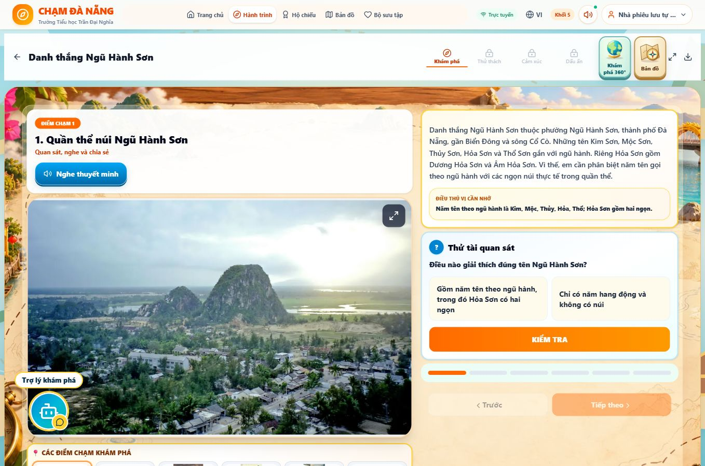
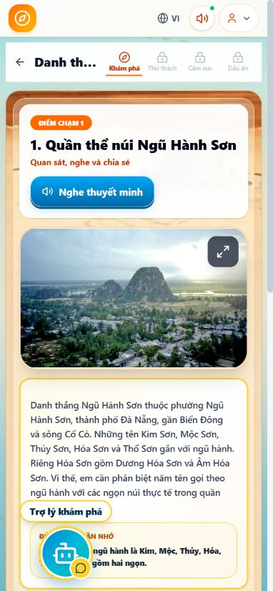
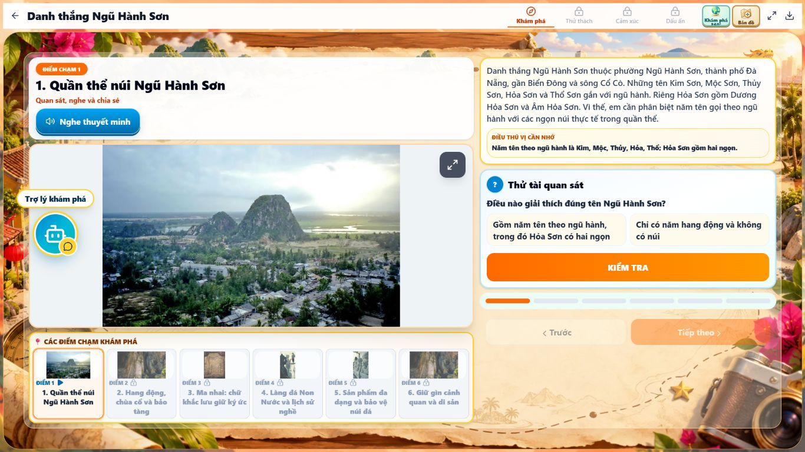
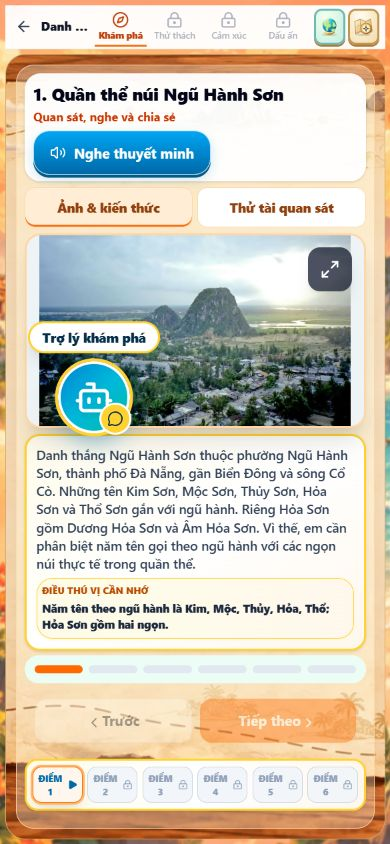

# Chặng 1 — Báo cáo kiểm tra âm thanh và giao diện (29/10/2026)

**Trạng thái: 121 MP3 đã tích hợp, 121/121 điểm đã kiểm tra phát trên bản thử. Đang phát hành cùng main mới nhất `76c9a94`, giữ nguyên trang chủ đã duyệt.**

Bản thử âm thanh: https://work-stage1-narration-121.chamdanang-gddp.pages.dev/

Bản thử giao diện gọn: https://98c97c40.chamdanang-gddp.pages.dev/ (commit `c1b25a564d6a25553235aa6a25148e55de14938c`).

## Kiểm tra Firestore ngày 29/10/2026 — điểm chặn đã hết

Đã mở Google Cloud Console đúng dự án `boreal-doodad-j6shk` theo ủy quyền bổ sung. Trang Quotas hiển thị free daily read units 6.445/50.000 (12,89%), write units 2/40.000. API công khai hiện báo Firestore đọc và ghi connected, Admin account exists=true và ready=true. Không đổi gói, hạn mức, database, quyền hay bí mật. Lỗi RESOURCE_EXHAUSTED của lượt trước hiện không còn xuất hiện; chưa khẳng định nguyên nhân tự phục hồi chỉ từ các trạng thái này.

Giữ main `76c9a94` làm nền phát hành để không ghi đè trang chủ mới. Bản dựng và TypeScript đạt; lỗi kiểm thử do clone thiếu commit lịch sử `39ddc40` đã được xử lý bằng fetch lịch sử, sau đó 22/22 kiểm thử grade45 đạt.

## Nguồn và bảo toàn

- Main gốc: `4aa5c652aff732fde1caeb3fc068090ad6670238`.
- Nhánh khôi phục: `backup/stage1-before-20261029`.
- Khối 1: `Khoi-1_20-MP3_DIEU-CHINH-BAO-VE-AM-DAU.zip` (20). Giữ nguyên byte của 20 MP3 mới; xóa đúng 20 đường dẫn cũ `g1-[1-5]-[1-4].mp3` đã đối chiếu. Không xóa nội dung hay ảnh.
- Khối 2: `Khối-2_Chặng-1_25-đoạn_ĐÃ-ĐỐI-CHIẾU.zip` (25). Rà bản gốc Khối-2.mp3, đặt lại đầu 25 đoạn vào giữa khoảng lặng đã đo để bảo vệ âm đầu; không đổi cuối đoạn, thứ tự hoặc lời đọc. Chi tiết: [grade2-cut-adjustments.json](grade2-cut-adjustments.json).
- Khối 3: `Khối-3_Chặng-1_20-đoạn.zip` (20), giữ nguyên byte.
- Khối 4: `Khoi-4_27-doan_ranh-gioi-am-thanh-an-toan.zip` (27), giữ nguyên byte. ID lấy từ bảng ÁNH-XẠ-ĐÚNG, không lấy từ số trạm hiển thị. [Bảng ID nguồn](grade4-id-mapping.json).
- Khối 5: `Khoi-5_29-MP3_DOI-CHIEU-VA-KIEM-TRA.zip` (29), giữ nguyên byte và ánh xạ manifest.
- Mỗi URL chứa 12 ký tự đầu SHA-256, toàn bộ digest được kiểm tra. Không còn URL cũ trong mã phát thuyết minh; một manifest duy nhất quản lý 121 điểm. Nội dung Admin khác lời ghi âm sẽ không phát bản thu lỗi thời.
- Giữ thứ tự trạm, dữ liệu giáo dục, ảnh, bản đồ, trò chơi và mã máy chủ/tài khoản. Giữ lại API gateway và xử lý URL học liệu đã có trên production `2558ff3`, tránh mất chức năng Admin khi main được triển khai lên cùng dự án Cloudflare. Giữ nguyên trang bìa đã duyệt trong main `76c9a94`; không khôi phục trang bìa cũ từ nhánh âm thanh.

## Kiểm tra từng trạm

Mỗi điểm bên dưới đã mở qua giao diện, nhấn nghe và xác nhận trạng thái đang phát. Đây là kiểm tra phát thực tế, không phải chứng nhận đã nghe trọn từng âm tiết bằng tai.

| Khối | ID trạm | Tên trạm | MP3 / điểm phát đạt |
|---|---|---|---|
| 1 | `g1-station-1` | Quê hương em | 4/4 |
| 1 | `g1-station-4` | Thành Điện Hải | 4/4 |
| 1 | `g1-station-2` | Trò chơi dân gian | 4/4 |
| 1 | `g1-station-3` | Những dòng suối ở thành phố Đà Nẵng | 4/4 |
| 1 | `g1-station-5` | Món ăn truyền thống | 4/4 |
| 2 | `g2-station-4` | Di sản văn hóa thế giới Hội An | 6/6 |
| 2 | `g2-station-3` | Nhà thờ Nguyễn Văn Thoại – Nhà lưu niệm Huỳnh Thúc Kháng | 4/4 |
| 2 | `g2-station-5` | Lễ hội truyền thống ở thành phố Đà Nẵng | 5/5 |
| 2 | `g2-station-2` | Cù Lao Chàm – Khu bảo tồn thiên nhiên Sơn Trà | 5/5 |
| 2 | `g2-station-1` | Chiếu Cẩm Nê – Chiếu Bàn Thạch | 5/5 |
| 3 | `g3-station-2` | Hoàng Diệu – Phan Châu Trinh | 4/4 |
| 3 | `g3-station-3` | Cộng đồng các dân tộc ở thành phố Đà Nẵng | 4/4 |
| 3 | `g3-station-1` | Bãi biển Mỹ Khê – Bãi biển Bàn Than | 4/4 |
| 3 | `g3-station-4` | Nước mắm Nam Ô | 4/4 |
| 3 | `g3-station-5` | Nghề đan thuyền thúng ở Sơn Trà | 4/4 |
| 4 | `g4-station-1` | Thiên nhiên và con người Đà Nẵng | 6/6 |
| 4 | `g4-station-3` | Tìm hiểu một số hoạt động kinh tế Đà Nẵng | 5/5 |
| 4 | `g4-station-2` | Khu đền tháp Mỹ Sơn – Bảo tàng Điêu khắc Chăm Đà Nẵng | 6/6 |
| 4 | `g4-thu-bon-hon-kem` | Sông Thu Bồn – Hòn Kẽm Đá Dừng | 5/5 |
| 4 | `g4-station-4` | Nghề đúc đồng ở Phước Kiều | 5/5 |
| 5 | `g5-ky-anh-me-nhu` | Địa đạo Kỳ Anh – Khu lưu niệm Mẹ Nhu và 07 Dũng sĩ Thanh Khê | 6/6 |
| 5 | `g5-station-3` | Bà Nà – Hải Vân Quan | 6/6 |
| 5 | `g5-station-4` | Danh thắng Ngũ Hành Sơn | 6/6 |
| 5 | `g5-lua-ma-chau` | Lụa Mã Châu | 5/5 |
| 5 | `g5-station-5` | Sâm Ngọc Linh | 6/6 |

Tổng: **25 trạm, 121/121 điểm**. Khối 1–5: **20 / 25 / 20 / 27 / 29**.

- [Kết quả từng điểm qua trình duyệt](browser-checks.json): 121 ID duy nhất; mỗi điểm một nút, nằm trên ảnh; ảnh hiển thị giải mã được; các viewport đã kiểm tra không tràn ngang.
- [Đối chiếu tệp, lời hiện hành và bản chép Descript](point-checks.json): 121 bản ghi, SHA-256, codec, thời lượng, biên tín hiệu và bản chép lời.
- Cả 121 tệp đều đúng codec MP3, giải mã thành công, không rỗng; không có khoảng lặng liên tục >=2 giây ở ngưỡng -42 dB. Peak lớn nhất 0.89641; RMS 0.08591–0.119; RMS đầu/cuối 120ms lớn nhất 0.00006. Các phép đo này không chứng nhận tuyệt đối không rè hoặc đúng mọi âm tiết.
- Mỗi điểm chỉ một nút **Nghe thuyết minh → Tạm dừng → Tiếp tục**; kết thúc về trạng thái nghe, bấm lại chính nút đó để phát từ đầu. Đã kiểm tra pause/resume, kết thúc/replay, chuyển điểm, đóng ảnh lớn và không tự phát khi mở điểm.
- Cửa sổ ảnh lớn chỉ một nút nghe có thể thao tác; nút trên ảnh. Giữ thư viện ảnh thật. Đóng cửa sổ dừng thuyết minh.
- Đã sửa dải điểm chạm tràn ngang do CSS `display:flex!important` cũ. Viewport điện thoại 390×844: document 382px. Desktop kiểm tra ở 1235px và 1366×900.
- 88/88 kiểm thử liên quan và 25/25 kiểm thử backend/auth/storage/sync đạt. `npm ci`, TypeScript, production Vite/PWA build đạt. Còn cảnh báo CSS escape và kích thước chunk vốn có; không có lỗi build.
- Không ghi nhận lỗi JavaScript ứng dụng khi lọc log theo domain app; trình duyệt có lỗi từ extension riêng, không dùng chúng để kết luận app lỗi.

## Giới hạn nội dung cần nghe xác minh

Không tuyên bố nghiệm thu tuyệt đối từng âm tiết. Bản chép Descript có các khác biệt sau; ASR có thể nhận dạng sai nên chưa đủ căn cứ sửa lời hoặc yêu cầu thu lại:

| Tệp nguồn | Lời hiện hành | Bản chép ASR / điều cần nghe |
|---|---|---|
| g5-1-4.mp3 | Lê Thị Dảnh | Lê Thị Rảnh |
| g5-2-2.mp3 | Debay | Dubet |
| g1-3-4.mp3 | Grăng, Bến Giằng | Răng, Bến Rằng |
| g3-3-2.mp3 | Da Dá | ra giá |
| g1-1-2.mp3 | ngôi trường | môi trường |
| g1-1-4.mp3 | chăm cây | trồng cây |
| g5-4-1.mp3 | xe tơ | se tơ |

Đối chiếu bổ sung tên viết từ nguồn cơ quan/chuyên môn, không thay nội dung giáo dục:
- https://vuthuvien.bvhttdl.gov.vn/tri-an-me-viet-nam-anh-hung/
- https://www.archives.org.vn/gioi-thieu-tai-lieu-nghiep-vu/ba-na-khi-hau-%E2%80%9Cdia-trung-hai%E2%80%9D-o-phuong-dong.htm

Các số viết bằng chữ, chữ số La Mã và chính tả vùng miền có thể làm giảm độ giống ASR; điểm giống không phải chứng nhận nghe thủ công. Không có đoạn nào bị kết luận sai chắc chắn chỉ bằng ASR; không tự tạo giọng thay thế hay sửa tên riêng.

## Chưa xác minh / vấn đề có sẵn

- API đã xác nhận Firestore đọc/ghi và Admin ready. Chưa đăng nhập thủ công bằng mật khẩu Admin/giáo viên trong lượt này; form không tự điền thông tin. Kiểm thử backend dùng dữ liệu giả lập không thay thế mọi thao tác tài khoản thật.
- Chưa kiểm tra trên điện thoại vật lý/iOS Safari; mobile là viewport Chrome.
- Chưa chơi trọn toàn bộ trò chơi Chặng 2 qua UI trong tác vụ này. Kiểm thử trò chơi, tiến độ, quà, bản đồ và phân quyền đạt; Chặng 3–4 không bị sửa. Bộ trò chơi dùng chung chỉ thay chiều cao nhúng theo vùng trống thực tế và khoảng cách màn giới thiệu; không thay câu hỏi, thưởng, âm thanh hay luật chơi.
- Vị trí Rita đã lưu trên trình duyệt có thể che giữa nút mở trạm đầu Khối 5. Đã dùng phần nút còn thấy để kiểm tra; không thay mã hoặc vị trí Rita.
- Tiến trình phát hành được kiểm tra trên đúng dự án Cloudflare `chamdanang-gddp`; không đổi dịch vụ hoặc database.

## Ảnh giao diện thực tế trên bản thử

Desktop (1366×900):

Điện thoại mô phỏng (390×844):

## Giao diện gọn theo yêu cầu bổ sung

- Một thanh điều hướng cao 44px, dùng lại khi toàn màn hình; bỏ thanh tiêu đề lặp. Khi vào trạm, dành toàn viewport cho bài học; quay lại danh sách để dùng thanh menu chung. Không thay trang chủ/video/nền Admin.
- Máy tính: ảnh và nội dung/câu hỏi hai cột; ảnh co theo phần không gian còn lại, giữ object-fit contain; dải điểm chạm nhỏ.
- Điện thoại: hai nút “Ảnh & kiến thức” và “Thử tài quan sát” để chuyển phần, giữ nguyên toàn bộ nội dung/câu hỏi. Không thu chữ đến mức khó đọc. Đổi điểm trở về phần quan sát.
- Chrome 1366×768: document 1366×768, lesson clientHeight=scrollHeight=709, toolbar clientHeight=scrollHeight=43 (sai số pixel CSS). Không cuộn ngang/dọc ở điểm kiểm tra.
- Chrome 390×844: document 390×844, lesson clientHeight=scrollHeight=785 ở cả phần quan sát và câu hỏi. Toolbar clientWidth=scrollWidth=380. Nút bản đồ/360° nằm gọn trong thanh, có aria-label khi ẩn nhãn chữ.
- Rà lại phát/tạm dừng/tiếp tục trên candidate mới; bản đồ mở/đóng đúng. Fullscreen fallback giữ đúng một thanh.
- Đi trọn 6 điểm Ngũ Hành Sơn qua các câu hỏi trên mobile: mở điểm, phần thưởng, chuyển Chặng 2 đúng. Màn giới thiệu và câu hỏi đầu Chặng 2 vừa viewport điện thoại.
- 88/88 kiểm thử liên quan +25/25 backend/auth/storage/sync; TypeScript và production build đạt sau sửa bố cục.
- Các phép đo gọn mới là mẫu đại diện, không thay thế bảng 121 điểm đã phát trên bản thử âm thanh trước đó. Khi viewport cực thấp, tăng cỡ chữ hoặc nội dung Admin dài hơn, vẫn cho cuộn dự phòng để không cắt mất nội dung. Không tuyên bố mọi thiết bị đều tuyệt đối không cuộn.

